# Sajiwa — Database ERD Data Dictionary (per section)

PostgreSQL 17 + pgvector. Final schema after `db/init/*.sql` + migrations `001…011`,
including the `005_naming` renames (`hotline → hotlines`, `jadwal_konsultasi → counseling_slots`,
`booking_konsultasi → counseling_bookings`).

**39 tables in 11 sections.** Each section gives you everything needed to draw an ERD and put
it into a table:

1. **Tables & function** — what each table stores and its role.
2. **Column dictionary** — every column with type, key, FK target, and what it means.
3. **Mermaid `erDiagram`** — the visual ERD for that section (kept small so it stays readable
   when converted to DOCX).

### Key legend

| Marker | Meaning |
|---|---|
| **PK** | Primary key |
| **FK** | Foreign key (target shown in *References*) |
| **UK** | Unique |
| **NN** | Not null |

On-delete behavior is shown after the FK target: `CASCADE`, `RESTRICT`, `SET NULL`.
`users` is the hub table — full definition in §1, shown compactly in later diagrams.

### Rendering to DOCX

Mermaid fences don't render in plain Pandoc. Either render each block with
**mermaid-cli** (`mmdc -i block.mmd -o block.png -w 1600`) and reference the PNGs, or use
`pandoc -F mermaid-filter`, which turns each block into an image. Splitting per section is
what keeps each image large enough to read.

---

## 1. Accounts & Auth

| Table | Function |
|---|---|
| `users` | Every account (student/counselor/admin/official) with password hash and profile. Hub of the schema. |
| `password_resets` | Hashed single-use OTP codes for forgot-password (15-min expiry). |
| `privacy_consents` | Records the one-time privacy acceptance per account. |

### Column dictionary

| Table | Column | Type | Key | References | Description |
|---|---|---|---|---|---|
| users | user_id | uuid | PK | — | Surrogate id of every account. |
| users | name | varchar(100) | NN | — | Full name. |
| users | email | varchar(100) | NN, UK | — | Login identifier; unique. |
| users | nim | varchar(14) | | — | Student ID number (mahasiswa only). |
| users | role | varchar(20) | NN | — | `mahasiswa / konselor / admin / pemangku_jabatan`. |
| users | password_hash | text | | — | bcrypt hash. |
| users | email_verified | boolean | NN | — | Email verification flag. |
| users | created_at | timestamptz | | — | Row creation time. |
| password_resets | email | varchar(100) | PK | users.email (logical, no FK) | Email the OTP was issued for. |
| password_resets | otp_hash | text | NN | — | bcrypt hash of the OTP. |
| password_resets | expires_at | timestamptz | NN | — | OTP expiry (15 min). |
| password_resets | used | boolean | NN | — | Single-use flag. |
| password_resets | created_at | timestamptz | NN | — | Row creation time. |
| privacy_consents | user_id | uuid | PK, FK | users(user_id) CASCADE | Account that accepted. |
| privacy_consents | accepted_at | timestamptz | NN | — | When the walkthrough was accepted. |

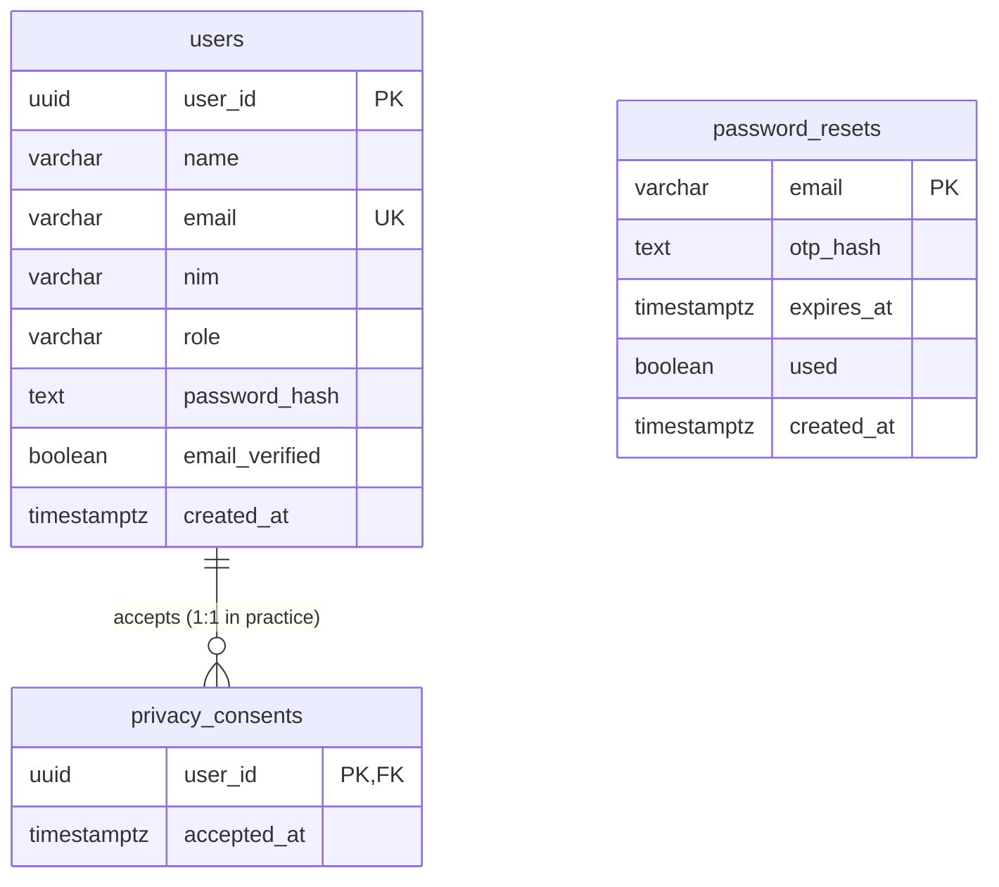

---

## 2. Academic Scoping

| Table | Function |
|---|---|
| `faculties` | Faculty taxonomy (seeded from UNDIP). |
| `academic_units` | Departments / study programs under a faculty. |
| `student_academic_profiles` | 1:1 student → faculty/unit; scopes analytics and reports. |

### Column dictionary

| Table | Column | Type | Key | References | Description |
|---|---|---|---|---|---|
| faculties | faculty_id | uuid | PK | — | Faculty id. |
| faculties | code | varchar(20) | UK | — | Short code (e.g. `FPSI`). |
| faculties | name | varchar(150) | NN, UK(ci) | — | Faculty name. |
| faculties | active | boolean | NN | — | Whether it appears in pickers. |
| faculties | source_url | text | | — | Source page the row came from. |
| faculties | created_at | timestamptz | NN | — | Row creation time. |
| faculties | updated_at | timestamptz | NN | — | Last update time. |
| academic_units | academic_unit_id | uuid | PK | — | Unit id. |
| academic_units | faculty_id | uuid | NN, FK | faculties(faculty_id) RESTRICT | Owning faculty. |
| academic_units | code | varchar(30) | | — | Short code. |
| academic_units | name | varchar(150) | NN | — | Unit name. |
| academic_units | unit_type | varchar(20) | NN | — | `department / study_program`. |
| academic_units | degree_level | varchar(20) | | — | e.g. `S1`. |
| academic_units | active | boolean | NN | — | Active flag. |
| academic_units | source_url | text | | — | Source page. |
| academic_units | created_at | timestamptz | NN | — | Row creation time. |
| academic_units | updated_at | timestamptz | NN | — | Last update time. |
| student_academic_profiles | user_id | uuid | PK, FK | users(user_id) CASCADE | Student account (1:1). |
| student_academic_profiles | faculty_id | uuid | FK | faculties(faculty_id) RESTRICT | Faculty the student belongs to. |
| student_academic_profiles | academic_unit_id | uuid | FK | academic_units (composite) RESTRICT | Study program. |
| student_academic_profiles | created_at | timestamptz | NN | — | Row creation time. |
| student_academic_profiles | updated_at | timestamptz | NN | — | Last update time. |

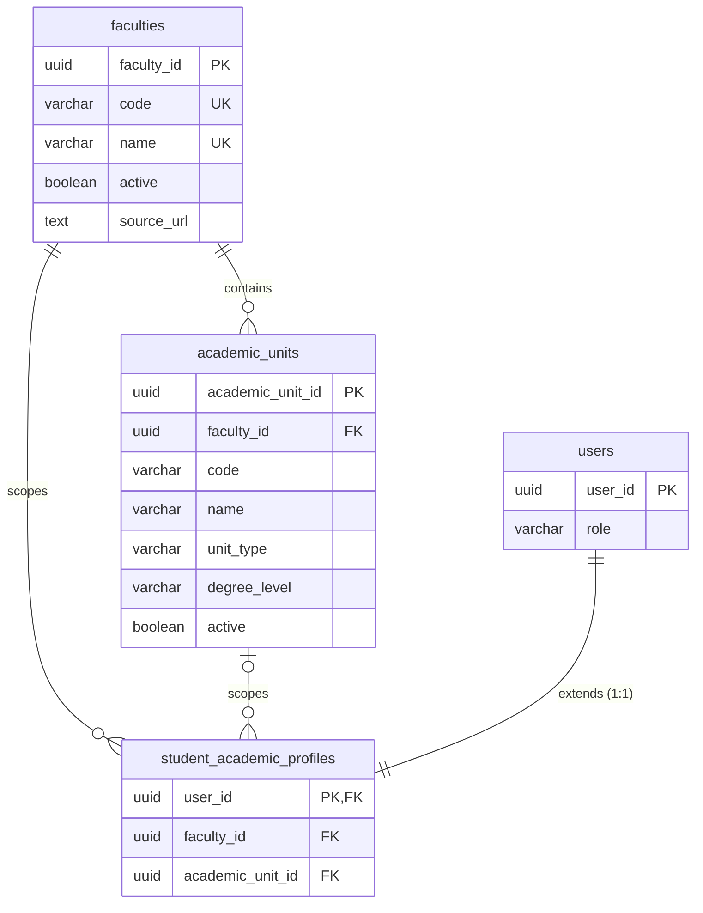

---

## 3. Chat, Journals & Safety Signals

| Table | Function |
|---|---|
| `sessions` | One chat session per student. |
| `messages` | Encrypted chat turns, pinned to (session, owner). |
| `journals` | Private journal entries with mood. |
| `guardrail_logs` | Every safety signal with its source, for admin review. |

### Column dictionary

| Table | Column | Type | Key | References | Description |
|---|---|---|---|---|---|
| sessions | session_id | text | PK | — | Client-generated session id. |
| sessions | user_id | uuid | NN, FK | users(user_id) CASCADE | Owning student. |
| sessions | title | text | | — | First user message, truncated. |
| sessions | started_at | timestamptz | | — | Session start. |
| sessions | ended_at | timestamptz | | — | Session end (nullable). |
| messages | message_id | uuid | PK | — | Message id. |
| messages | session_id | text | NN, FK | sessions(session_id, user_id) CASCADE | Part of composite FK. |
| messages | user_id | uuid | NN, FK | sessions(session_id, user_id) CASCADE | Owner; must match session owner. |
| messages | role | text | NN | — | `user / assistant`. |
| messages | content | text | NN | — | Fernet ciphertext (never plaintext). |
| messages | route_used | text | | — | LLM route that produced the reply. |
| messages | created_at | timestamptz | | — | Row creation time. |
| journals | journal_id | uuid | PK | — | Entry id. |
| journals | user_id | uuid | NN, FK | users(user_id) CASCADE | Owning student. |
| journals | content | text | NN | — | Entry text. |
| journals | mood | varchar(20) | | — | `calm / anxious / focused / tired`. |
| journals | created_at | timestamptz | | — | Row creation time. |
| journals | updated_at | timestamptz | | — | Last update time. |
| guardrail_logs | guardrail_log_id | uuid | PK | — | Signal id. |
| guardrail_logs | user_id | uuid | FK | users(user_id) SET NULL | User who triggered it. |
| guardrail_logs | session_id | text | | — | Chat session if source=chat. |
| guardrail_logs | triggered_input | text | | — | The flagged input. |
| guardrail_logs | source | text | | — | `chat / assessment`. |
| guardrail_logs | assessment_id | uuid | FK | assessments(assessment_id) SET NULL | Assessment if source=assessment. |
| guardrail_logs | is_read | boolean | | — | Review flag. |
| guardrail_logs | notified_at | timestamptz | | — | When admin was notified. |

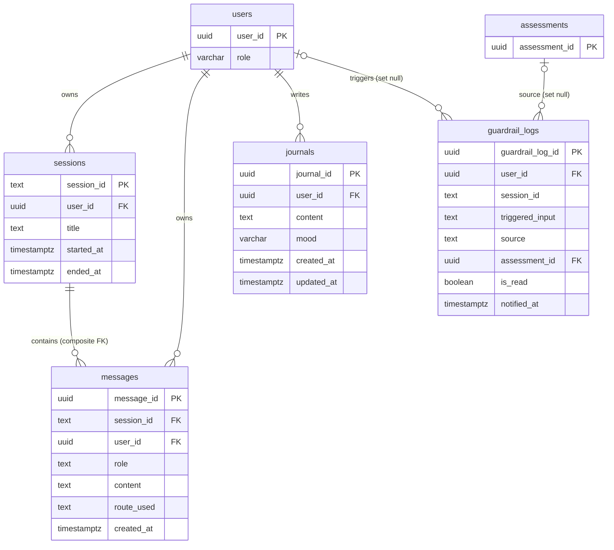

---

## 4. Assessment Results

| Table | Function |
|---|---|
| `assessments` | Self-assessment attempts (PHQ-9/GAD-7/SRQ legacy + DASS-21/versioned). |
| `assessment_category_results` | Per-category scores for versioned instruments (DASS-21 subscales). |

### Column dictionary

| Table | Column | Type | Key | References | Description |
|---|---|---|---|---|---|
| assessments | assessment_id | uuid | PK | — | Attempt id. |
| assessments | user_id | uuid | NN, FK | users(user_id) CASCADE | Student who submitted. |
| assessments | instrument_type | varchar(20) | NN | — | `PHQ-9 / GAD-7 / SRQ / DASS-21`. |
| assessments | answers | jsonb | NN | — | Raw answers. |
| assessments | score | int | NN | — | Total score. |
| assessments | severity | varchar(20) | NN | — | `minimal / mild / moderate / severe`. |
| assessments | taken_at | timestamptz | | — | Submission time. |
| assessments | instrument_version_id | uuid | FK | assessment_instrument_versions RESTRICT | Version used (versioned instruments). |
| assessment_category_results | assessment_category_result_id | uuid | PK | — | Result id. |
| assessment_category_results | assessment_id | uuid | NN, FK | assessments(assessment_id) CASCADE | Parent attempt. |
| assessment_category_results | instrument_version_id | uuid | NN, FK | assessment_instrument_versions RESTRICT | Version scored against. |
| assessment_category_results | category | varchar(20) | NN | — | `depression / anxiety / stress`. |
| assessment_category_results | raw_score | int | NN | — | Raw subscale score. |
| assessment_category_results | scaled_score | numeric | | — | Standardized score (×2 for DASS-21). |
| assessment_category_results | severity | varchar(40) | | — | Band label. |
| assessment_category_results | created_at | timestamptz | NN | — | Row creation time. |

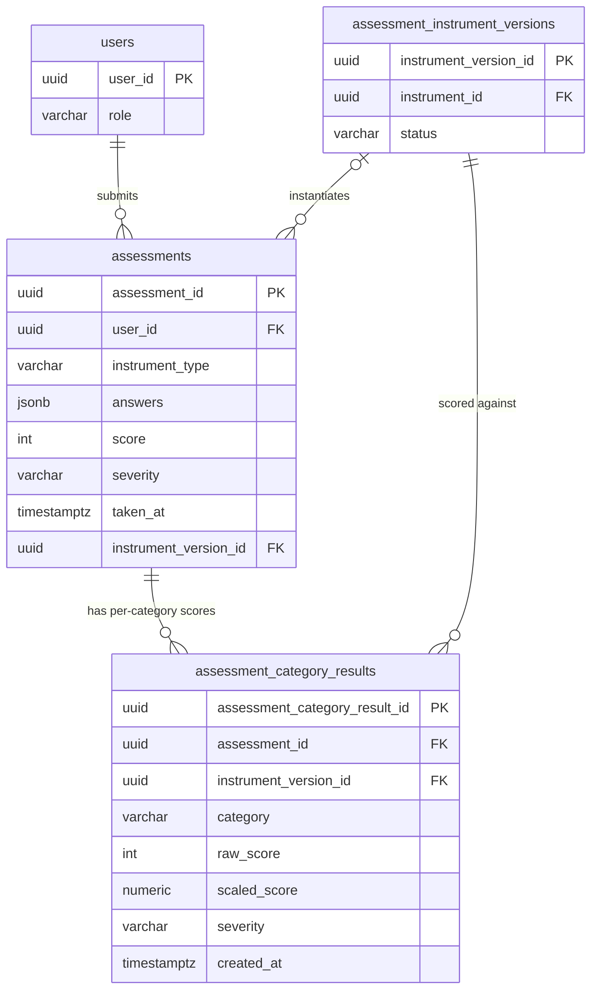

---

## 5. Instrument Authoring (versioned)

| Table | Function |
|---|---|
| `assessment_instruments` | Instrument metadata (code, name, language, kind, norms). |
| `assessment_instrument_versions` | Draft → published → archived versions with scoring config. |
| `assessment_questions` | Items per version (wording, category, position). |
| `assessment_answer_options` | Scored options per question. |
| `assessment_dimensions` | Dimension rows and interpretation bands per version. |
| `assessment_version_reviews` | Counselor review gate (publish requires approval). |
| `assessment_review_comments` | Reviewer comment thread on a review. |

### Column dictionary

| Table | Column | Type | Key | References | Description |
|---|---|---|---|---|---|
| assessment_instruments | instrument_id | uuid | PK | — | Instrument id. |
| assessment_instruments | code | varchar(40) | NN, UK(ci) | — | Short code (e.g. `DASS-21`). |
| assessment_instruments | name | varchar(160) | NN | — | Display name. |
| assessment_instruments | description | text | | — | Purpose / reference. |
| assessment_instruments | active | boolean | NN | — | Visible to students flag. |
| assessment_instruments | language | varchar(40) | | — | e.g. `Bahasa Indonesia`. |
| assessment_instruments | instrument_kind | varchar(20) | NN | — | `standard / custom`. |
| assessment_instruments | derived_from_instrument_id | uuid | FK | assessment_instruments RESTRICT | Parent instrument (self-ref). |
| assessment_instruments | norms_enabled | boolean | NN | — | Whether norms/scoring apply. |
| assessment_instruments | provenance | jsonb | NN | — | Source references + wording hash. |
| assessment_instruments | dass21_subscales | text[] | | — | Allowed DASS-21 subscales. |
| assessment_instruments | shown_in_app | boolean | NN | — | At most one instrument shown in app. |
| assessment_instruments | created_by | uuid | FK | users(user_id) RESTRICT | Creator. |
| assessment_instruments | updated_by | uuid | FK | users(user_id) RESTRICT | Last editor. |
| assessment_instruments | created_at | timestamptz | NN | — | Row creation time. |
| assessment_instruments | updated_at | timestamptz | NN | — | Last update time. |
| assessment_instrument_versions | instrument_version_id | uuid | PK | — | Version id. |
| assessment_instrument_versions | instrument_id | uuid | NN, FK | assessment_instruments RESTRICT | Parent instrument. |
| assessment_instrument_versions | version_number | int | NN, UK | — | Ordinal within instrument. |
| assessment_instrument_versions | status | varchar(20) | NN | — | `draft / published / archived`. |
| assessment_instrument_versions | expected_question_count | int | NN | — | Expected item count (21). |
| assessment_instrument_versions | authoritative_config | boolean | NN | — | Canonical scoring flag. |
| assessment_instrument_versions | scoring_config | jsonb | | — | Response scores, bands, multiplier. |
| assessment_instrument_versions | definition_revision | int | NN | — | Immutable after publish. |
| assessment_instrument_versions | created_by | uuid | FK | users(user_id) RESTRICT | Creator. |
| assessment_instrument_versions | updated_by | uuid | FK | users(user_id) RESTRICT | Last editor. |
| assessment_instrument_versions | published_by | uuid | FK | users(user_id) RESTRICT | Publisher. |
| assessment_instrument_versions | created_at | timestamptz | NN | — | Row creation time. |
| assessment_instrument_versions | updated_at | timestamptz | NN | — | Last update time. |
| assessment_instrument_versions | published_at | timestamptz | | — | Publish time. |
| assessment_questions | assessment_question_id | uuid | PK | — | Item id. |
| assessment_questions | instrument_version_id | uuid | NN, FK | assessment_instrument_versions CASCADE | Parent version. |
| assessment_questions | item_key | varchar(60) | NN, UK | — | Stable key (e.g. `DASS21-01`). |
| assessment_questions | category | varchar(60) | NN | — | Subscale / category tag. |
| assessment_questions | position | int | NN, UK | — | Display order. |
| assessment_questions | wording | text | NN | — | Question text. |
| assessment_questions | active | boolean | NN | — | Included in scoring. |
| assessment_questions | assessment_dimension_id | uuid | FK | assessment_dimensions(assessment_dimension_id) RESTRICT | Dimension grouping. |
| assessment_questions | created_at | timestamptz | NN | — | Row creation time. |
| assessment_questions | updated_at | timestamptz | NN | — | Last update time. |
| assessment_answer_options | assessment_answer_option_id | uuid | PK | — | Option id. |
| assessment_answer_options | assessment_question_id | uuid | NN, FK | assessment_questions CASCADE | Parent question. |
| assessment_answer_options | position | int | NN, UK | — | Display order (0-based). |
| assessment_answer_options | label | text | NN | — | Option text. |
| assessment_answer_options | score | int | NN | — | Points for this option. |
| assessment_answer_options | created_at | timestamptz | NN | — | Row creation time. |
| assessment_answer_options | updated_at | timestamptz | NN | — | Last update time. |
| assessment_dimensions | assessment_dimension_id | uuid | PK | — | Dimension id. |
| assessment_dimensions | instrument_version_id | uuid | NN, FK | assessment_instrument_versions CASCADE | Parent version. |
| assessment_dimensions | code | varchar(60) | NN, UK | — | Dimension code. |
| assessment_dimensions | name | varchar(160) | NN | — | Dimension name. |
| assessment_dimensions | description | varchar(1000) | | — | What it measures. |
| assessment_dimensions | position | int | NN, UK | — | Display order. |
| assessment_dimensions | multiplier | numeric(10,4) | NN | — | Score multiplier. |
| assessment_dimensions | interpretation_bands | jsonb | NN | — | Severity bands. |
| assessment_dimensions | created_at | timestamptz | NN | — | Row creation time. |
| assessment_version_reviews | assessment_version_review_id | uuid | PK | — | Review id. |
| assessment_version_reviews | instrument_version_id | uuid | NN, FK | assessment_instrument_versions RESTRICT | Version under review. |
| assessment_version_reviews | definition_revision | int | NN | — | Revision being reviewed. |
| assessment_version_reviews | status | varchar(24) | NN | — | `pending / revision_requested / approved`. |
| assessment_version_reviews | submitted_by | uuid | NN, FK | users(user_id) RESTRICT | Submitter. |
| assessment_version_reviews | reviewer_user_id | uuid | FK | users(user_id) RESTRICT | Reviewing counselor. |
| assessment_version_reviews | submitted_at | timestamptz | NN | — | Submission time. |
| assessment_version_reviews | decided_at | timestamptz | | — | Decision time. |
| assessment_version_reviews | decision_comment | varchar(4000) | | — | Decision note. |
| assessment_version_reviews | created_at | timestamptz | NN | — | Row creation time. |
| assessment_version_reviews | updated_at | timestamptz | NN | — | Last update time. |
| assessment_review_comments | review_comment_id | uuid | PK | — | Comment id. |
| assessment_review_comments | assessment_version_review_id | uuid | NN, FK | assessment_version_reviews CASCADE | Parent review. |
| assessment_review_comments | assessment_question_id | uuid | FK | assessment_questions SET NULL | Question the comment targets. |
| assessment_review_comments | author_user_id | uuid | NN, FK | users(user_id) RESTRICT | Comment author. |
| assessment_review_comments | comment_text | varchar(4000) | NN | — | Comment body. |
| assessment_review_comments | created_at | timestamptz | NN | — | Row creation time. |

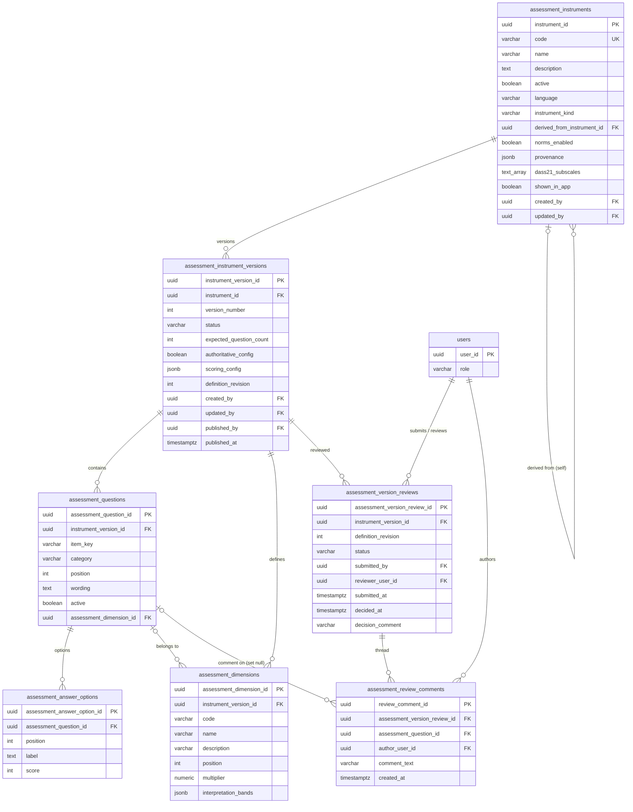

---

## 6. Safety & Support Resources

| Table | Function |
|---|---|
| `hotlines` | Crisis contacts with verification lifecycle. |
| `student_support_profiles` | 1:1 structured support/disability info recorded by admins. |

### Column dictionary

| Table | Column | Type | Key | References | Description |
|---|---|---|---|---|---|
| hotlines | hotline_id | uuid | PK | — | Hotline id. |
| hotlines | name | varchar(100) | NN | — | Service name. |
| hotlines | phone | varchar(20) | NN | — | Contact number. |
| hotlines | description | text | | — | What the service offers. |
| hotlines | verification_status | varchar(24) | NN | — | `active / verification_required / inactive`. |
| hotlines | verified_at | timestamptz | | — | When verified. |
| hotlines | verified_by | uuid | FK | users(user_id) RESTRICT | Admin who verified. |
| hotlines | verification_note | varchar(1000) | | — | Verification note. |
| hotlines | created_at | timestamptz | | — | Row creation time. |
| hotlines | updated_at | timestamptz | | — | Last update time. |
| hotlines | updated_by | uuid | FK | users(user_id) RESTRICT | Last editor. |
| student_support_profiles | user_id | uuid | PK, FK | users(user_id) CASCADE | Student account (1:1). |
| student_support_profiles | mental_health_condition_state | varchar(24) | NN | — | `none / present / unknown / prefer_not_to_say`. |
| student_support_profiles | disability_state | varchar(24) | NN | — | `none / present / unknown / prefer_not_to_say`. |
| student_support_profiles | condition_details | varchar(1000) | | — | Free-text condition detail. |
| student_support_profiles | disability_details | varchar(1000) | | — | Free-text disability detail. |
| student_support_profiles | updated_by | uuid | NN, FK | users(user_id) RESTRICT | Admin who recorded it. |
| student_support_profiles | created_at | timestamptz | NN | — | Row creation time. |
| student_support_profiles | updated_at | timestamptz | NN | — | Last update time. |

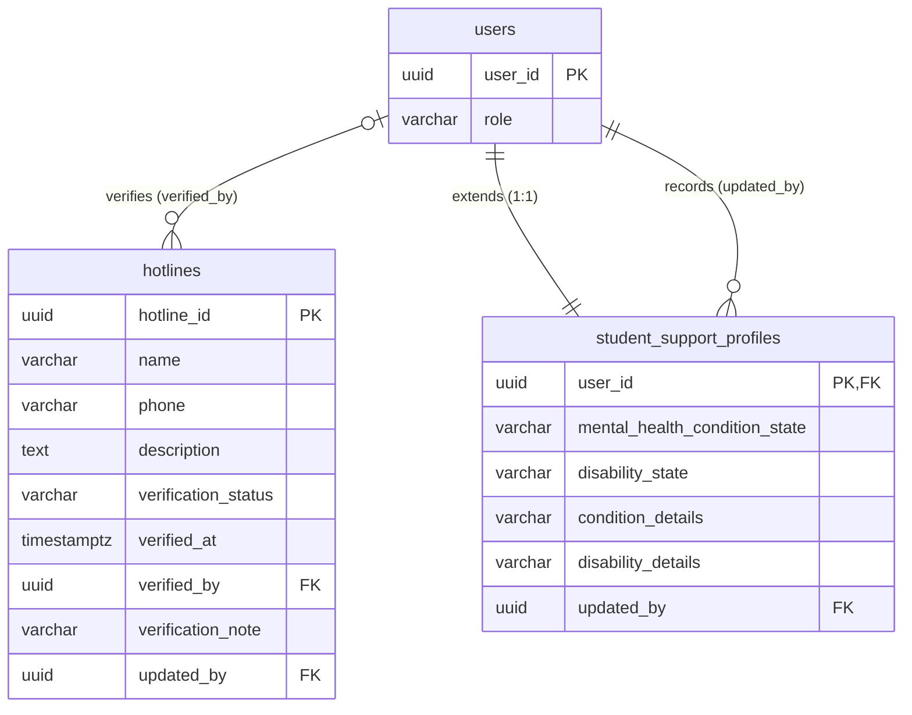

---

## 7. Counseling — Requests, Appointments & Resources (current flow)

| Table | Function |
|---|---|
| `counseling_requests` | Student's counseling request (context, status, preferred slot). |
| `counseling_appointments` | Confirmed/rescheduled sessions with time, counselor, resource. |
| `counseling_appointment_events` | Status-change audit trail per appointment. |
| `counseling_admin_notes` | Admin notes on a request or appointment. |
| `counseling_resources` | Bookable rooms/resources with capacity. |
| `counseling_resource_blocks` | Resource blackout intervals. |

### Column dictionary

| Table | Column | Type | Key | References | Description |
|---|---|---|---|---|---|
| counseling_requests | counseling_request_id | uuid | PK | — | Request id. |
| counseling_requests | student_id | uuid | NN, FK | users(user_id) CASCADE | Student requesting. |
| counseling_requests | status | varchar(20) | NN | — | `requested / confirmed / completed / cancelled / rescheduled / no_show`. |
| counseling_requests | preferred_context | varchar(250) | | — | Student's preferred discussion context. |
| counseling_requests | preferred_counselor_id | uuid | FK | users(user_id) SET NULL | Preferred counselor. |
| counseling_requests | preferred_starts_at | timestamptz | | — | Preferred slot start. |
| counseling_requests | preferred_ends_at | timestamptz | | — | Preferred slot end. |
| counseling_requests | created_at | timestamptz | NN | — | Row creation time. |
| counseling_requests | updated_at | timestamptz | NN | — | Last update time. |
| counseling_appointments | counseling_appointment_id | uuid | PK | — | Appointment id. |
| counseling_appointments | counseling_request_id | uuid | UK, FK | counseling_requests RESTRICT | Source request (0..1). |
| counseling_appointments | legacy_counseling_booking_id | uuid | UK, FK | counseling_bookings RESTRICT | Legacy booking link. |
| counseling_appointments | student_id | uuid | NN, FK | users(user_id) RESTRICT | Student. |
| counseling_appointments | counselor_id | uuid | NN, FK | users(user_id) RESTRICT | Counselor. |
| counseling_appointments | starts_at | timestamptz | NN | — | Start time. |
| counseling_appointments | ends_at | timestamptz | NN | — | End time. |
| counseling_appointments | status | varchar(20) | NN | — | `confirmed / completed / cancelled / rescheduled / no_show`. |
| counseling_appointments | counseling_resource_id | uuid | FK | counseling_resources RESTRICT | Booked resource. |
| counseling_appointments | created_by | uuid | NN, FK | users(user_id) RESTRICT | Admin who assigned. |
| counseling_appointments | created_at | timestamptz | NN | — | Row creation time. |
| counseling_appointments | updated_at | timestamptz | NN | — | Last update time. |
| counseling_appointment_events | appointment_event_id | uuid | PK | — | Event id. |
| counseling_appointment_events | counseling_appointment_id | uuid | NN, FK | counseling_appointments CASCADE | Parent appointment. |
| counseling_appointment_events | event_type | varchar(20) | NN | — | `assigned / confirmed / rescheduled / cancelled / completed / no_show`. |
| counseling_appointment_events | actor_user_id | uuid | NN, FK | users(user_id) RESTRICT | Who made the change. |
| counseling_appointment_events | previous_values | jsonb | NN | — | State before. |
| counseling_appointment_events | new_values | jsonb | NN | — | State after. |
| counseling_appointment_events | created_at | timestamptz | NN | — | Row creation time. |
| counseling_admin_notes | counseling_admin_note_id | uuid | PK | — | Note id. |
| counseling_admin_notes | counseling_request_id | uuid | FK | counseling_requests CASCADE | Request the note is on. |
| counseling_admin_notes | counseling_appointment_id | uuid | FK | counseling_appointments CASCADE | Appointment the note is on. |
| counseling_admin_notes | author_user_id | uuid | NN, FK | users(user_id) RESTRICT | Authoring admin. |
| counseling_admin_notes | note_text | text | NN | — | Note body. |
| counseling_admin_notes | created_at | timestamptz | NN | — | Row creation time. |
| counseling_admin_notes | updated_at | timestamptz | NN | — | Last update time. |
| counseling_resources | counseling_resource_id | uuid | PK | — | Resource id. |
| counseling_resources | name | varchar(160) | NN, UK(ci) | — | Room/resource name. |
| counseling_resources | resource_type | varchar(16) | NN | — | `physical / virtual`. |
| counseling_resources | capacity | int | NN | — | Capacity (1–100). |
| counseling_resources | location_or_url | varchar(500) | | — | Room location or meeting URL. |
| counseling_resources | active | boolean | NN | — | Bookable flag. |
| counseling_resources | created_by | uuid | NN, FK | users(user_id) RESTRICT | Creator. |
| counseling_resources | created_at | timestamptz | NN | — | Row creation time. |
| counseling_resources | updated_at | timestamptz | NN | — | Last update time. |
| counseling_resource_blocks | counseling_resource_block_id | uuid | PK | — | Block id. |
| counseling_resource_blocks | counseling_resource_id | uuid | NN, FK | counseling_resources CASCADE | Resource blocked. |
| counseling_resource_blocks | starts_at | timestamptz | NN | — | Block start. |
| counseling_resource_blocks | ends_at | timestamptz | NN | — | Block end. |
| counseling_resource_blocks | reason | varchar(250) | | — | Why it's blocked. |
| counseling_resource_blocks | created_by | uuid | NN, FK | users(user_id) RESTRICT | Creator. |
| counseling_resource_blocks | created_at | timestamptz | NN | — | Row creation time. |

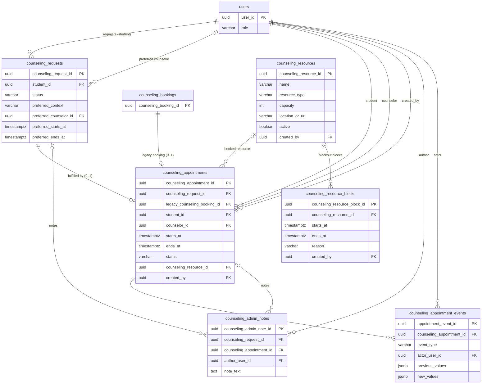

---

## 8. Counseling — Counselor & Scheduling

| Table | Function |
|---|---|
| `counselor_profiles` | 1:1 counselor title/specialization/active. |
| `counselor_availability_rules` | Weekly availability windows per counselor. |
| `counselor_blocked_periods` | Counselor time-off intervals. |
| `counselor_case_assignments` | Which counselor currently has access to which student's case. |
| `counselor_exception_requests` | Time-off requests (admin approves → creates a blocked period). |

### Column dictionary

| Table | Column | Type | Key | References | Description |
|---|---|---|---|---|---|
| counselor_profiles | user_id | uuid | PK, FK | users(user_id) CASCADE | Counselor account (1:1). |
| counselor_profiles | title | varchar(100) | | — | e.g. `Psikolog`. |
| counselor_profiles | specialization | varchar(250) | | — | Areas of expertise. |
| counselor_profiles | active | boolean | NN | — | Available for assignment. |
| counselor_profiles | created_at | timestamptz | NN | — | Row creation time. |
| counselor_profiles | updated_at | timestamptz | NN | — | Last update time. |
| counselor_availability_rules | counselor_availability_rule_id | uuid | PK | — | Rule id. |
| counselor_availability_rules | counselor_id | uuid | NN, FK | users(user_id) CASCADE | Counselor. |
| counselor_availability_rules | day_of_week | smallint | NN | — | 0 (Sun) – 6 (Sat). |
| counselor_availability_rules | start_time | time | NN | — | Window start. |
| counselor_availability_rules | end_time | time | NN | — | Window end. |
| counselor_availability_rules | timezone | varchar(50) | NN | — | Rule timezone (default Asia/Jakarta). |
| counselor_availability_rules | effective_from | date | | — | Rule valid from. |
| counselor_availability_rules | effective_to | date | | — | Rule valid to. |
| counselor_availability_rules | active | boolean | NN | — | Rule active. |
| counselor_availability_rules | created_at | timestamptz | NN | — | Row creation time. |
| counselor_availability_rules | updated_at | timestamptz | NN | — | Last update time. |
| counselor_blocked_periods | counselor_blocked_period_id | uuid | PK | — | Block id. |
| counselor_blocked_periods | counselor_id | uuid | NN, FK | users(user_id) CASCADE | Counselor. |
| counselor_blocked_periods | starts_at | timestamptz | NN | — | Block start. |
| counselor_blocked_periods | ends_at | timestamptz | NN | — | Block end. |
| counselor_blocked_periods | reason | varchar(250) | | — | Why blocked. |
| counselor_blocked_periods | created_by | uuid | NN, FK | users(user_id) RESTRICT | Creator. |
| counselor_blocked_periods | created_at | timestamptz | NN | — | Row creation time. |
| counselor_case_assignments | counselor_case_assignment_id | uuid | PK | — | Assignment id. |
| counselor_case_assignments | counselor_id | uuid | NN, FK | users(user_id) RESTRICT | Counselor. |
| counselor_case_assignments | student_id | uuid | NN, FK | users(user_id) CASCADE | Student. |
| counselor_case_assignments | status | varchar(16) | NN | — | `active / revoked`. |
| counselor_case_assignments | created_by | uuid | FK | users(user_id) SET NULL | Creator. |
| counselor_case_assignments | revoked_by | uuid | FK | users(user_id) SET NULL | Who revoked. |
| counselor_case_assignments | created_at | timestamptz | NN | — | Row creation time. |
| counselor_case_assignments | revoked_at | timestamptz | | — | Revocation time. |
| counselor_case_assignments | updated_at | timestamptz | NN | — | Last update time. |
| counselor_exception_requests | counselor_exception_request_id | uuid | PK | — | Request id. |
| counselor_exception_requests | counselor_id | uuid | NN, FK | users(user_id) RESTRICT | Requesting counselor. |
| counselor_exception_requests | starts_at | timestamptz | NN | — | Time off start. |
| counselor_exception_requests | ends_at | timestamptz | NN | — | Time off end. |
| counselor_exception_requests | full_day | boolean | NN | — | Whole-day flag. |
| counselor_exception_requests | reason | varchar(250) | NN | — | Reason for time off. |
| counselor_exception_requests | note | varchar(1000) | | — | Extra detail. |
| counselor_exception_requests | status | varchar(16) | NN | — | `pending / approved / rejected / cancelled`. |
| counselor_exception_requests | affected_appointment_ids | uuid[] | NN | — | Appointments the time off overlaps. |
| counselor_exception_requests | reviewed_by | uuid | FK | users(user_id) SET NULL | Reviewing admin. |
| counselor_exception_requests | reviewed_at | timestamptz | | — | Decision time. |
| counselor_exception_requests | decision_note | varchar(1000) | | — | Decision note. |
| counselor_exception_requests | counselor_blocked_period_id | uuid | UK, FK | counselor_blocked_periods SET NULL | Block created on approval. |
| counselor_exception_requests | created_at | timestamptz | NN | — | Row creation time. |
| counselor_exception_requests | updated_at | timestamptz | NN | — | Last update time. |

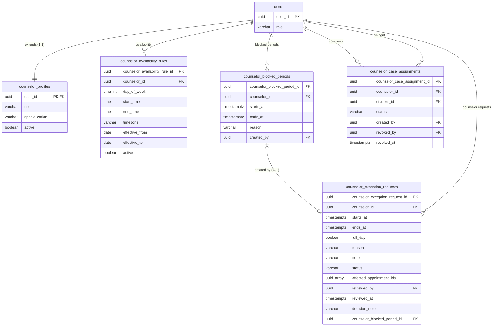

---

## 9. Counseling — Legacy Slots & Bookings (superseded)

| Table | Function |
|---|---|
| `counseling_slots` | Counselor-published time slots (old booking flow). |
| `counseling_bookings` | Student bookings of a slot (old flow). |

Superseded by §7 for new bookings; kept while `/jadwal` + `/booking` routes and admin history
views still serve it.

### Column dictionary

| Table | Column | Type | Key | References | Description |
|---|---|---|---|---|---|
| counseling_slots | counseling_slot_id | uuid | PK | — | Slot id. |
| counseling_slots | counselor_id | uuid | NN, FK | users(user_id) CASCADE | Counselor. |
| counseling_slots | date | date | NN | — | Slot date. |
| counseling_slots | start_time | time | NN | — | Slot start. |
| counseling_slots | end_time | time | NN | — | Slot end. |
| counseling_slots | status | varchar(20) | NN | — | `available / booked / completed / cancelled`. |
| counseling_slots | created_at | timestamptz | | — | Row creation time. |
| counseling_bookings | counseling_booking_id | uuid | PK | — | Booking id. |
| counseling_bookings | counseling_slot_id | uuid | NN, FK | counseling_slots RESTRICT | Slot booked. |
| counseling_bookings | student_id | uuid | NN, FK | users(user_id) CASCADE | Booking student. |
| counseling_bookings | status | varchar(20) | NN | — | `pending / confirmed / completed / cancelled`. |
| counseling_bookings | notes | text | | — | Booking note. |
| counseling_bookings | created_at | timestamptz | | — | Row creation time. |

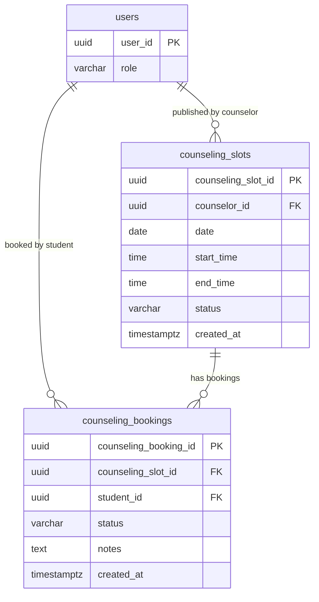

---

## 10. Notifications

| Table | Function |
|---|---|
| `admin_notifications` | Deduped admin inbox items (alerts from triggers). |
| `notifications` | Per-recipient student/counselor notifications (written by triggers). |

### Column dictionary

| Table | Column | Type | Key | References | Description |
|---|---|---|---|---|---|
| admin_notifications | admin_notification_id | uuid | PK | — | Notification id. |
| admin_notifications | admin_user_id | uuid | NN, FK | users(user_id) CASCADE | Admin recipient. |
| admin_notifications | category | varchar(20) | NN | — | `assessment / safety / counseling / schedule / system`. |
| admin_notifications | title | varchar(160) | NN | — | Subject. |
| admin_notifications | context | varchar(300) | | — | Short body. |
| admin_notifications | entity_type | varchar(40) | | — | Referenced entity kind. |
| admin_notifications | entity_id | uuid | | — | Referenced entity id. |
| admin_notifications | target_path | varchar(300) | | — | Dashboard route to open. |
| admin_notifications | read_at | timestamptz | | — | Read time. |
| admin_notifications | dedupe_key | varchar(200) | UK | — | Dedup key (partial UK). |
| admin_notifications | created_at | timestamptz | NN | — | Row creation time. |
| notifications | notification_id | uuid | PK | — | Notification id. |
| notifications | user_id | uuid | NN, FK | users(user_id) CASCADE | Recipient. |
| notifications | category | varchar(20) | NN | — | `counseling / schedule / system`. |
| notifications | title | varchar(160) | NN | — | Subject. |
| notifications | body | varchar(300) | | — | Body (times/names only). |
| notifications | target_path | varchar(300) | | — | App route to open. |
| notifications | entity_type | varchar(40) | | — | Referenced entity kind. |
| notifications | entity_id | uuid | | — | Referenced entity id. |
| notifications | dedupe_key | varchar(200) | UK | — | Dedup key (partial UK). |
| notifications | read_at | timestamptz | | — | Read time. |
| notifications | created_at | timestamptz | NN | — | Row creation time. |

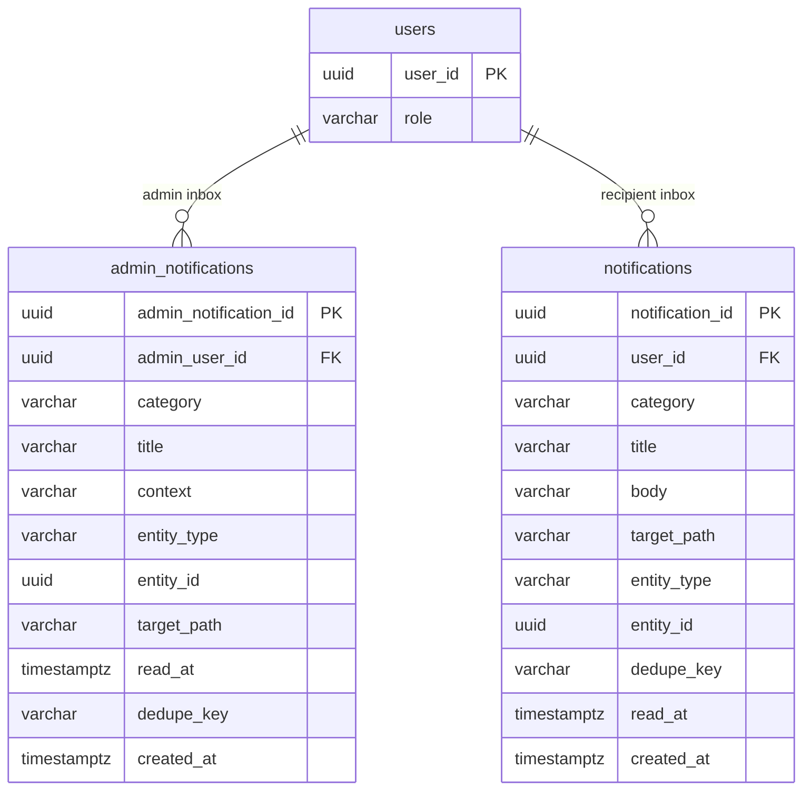

---

## 11. Ops & Infra

| Table | Function |
|---|---|
| `report_export_audits` | Audit rows for report exports. |
| `documents` | RAG vector store (content + `vector(768)` embedding). |
| `schema_migrations` | Applied-migration bookkeeping. |

### Column dictionary

| Table | Column | Type | Key | References | Description |
|---|---|---|---|---|---|
| report_export_audits | report_export_audit_id | uuid | PK | — | Audit row id. |
| report_export_audits | admin_user_id | uuid | NN, FK | users(user_id) RESTRICT | Exporting admin. |
| report_export_audits | report_mode | varchar(20) | NN | — | `aggregate / confidential`. |
| report_export_audits | faculty_id | uuid | FK | faculties(faculty_id) RESTRICT | Scope filter. |
| report_export_audits | academic_unit_id | uuid | FK | academic_units RESTRICT | Scope filter. |
| report_export_audits | date_from | date | NN | — | Range start. |
| report_export_audits | date_to | date | NN | — | Range end. |
| report_export_audits | exported_at | timestamptz | NN | — | Export time. |
| report_export_audits | scope | jsonb | NN | — | Faculty/unit id lists. |
| documents | document_id | bigint | PK | — | Chunk id (bigserial). |
| documents | content | text | NN | — | Chunk text. |
| documents | embedding | vector(768) | | — | Chunk embedding. |
| documents | metadata | jsonb | | — | Source metadata. |
| documents | created_at | timestamptz | | — | Row creation time. |
| schema_migrations | version | varchar(100) | PK | — | Migration file version. |
| schema_migrations | applied_at | timestamptz | NN | — | When applied. |

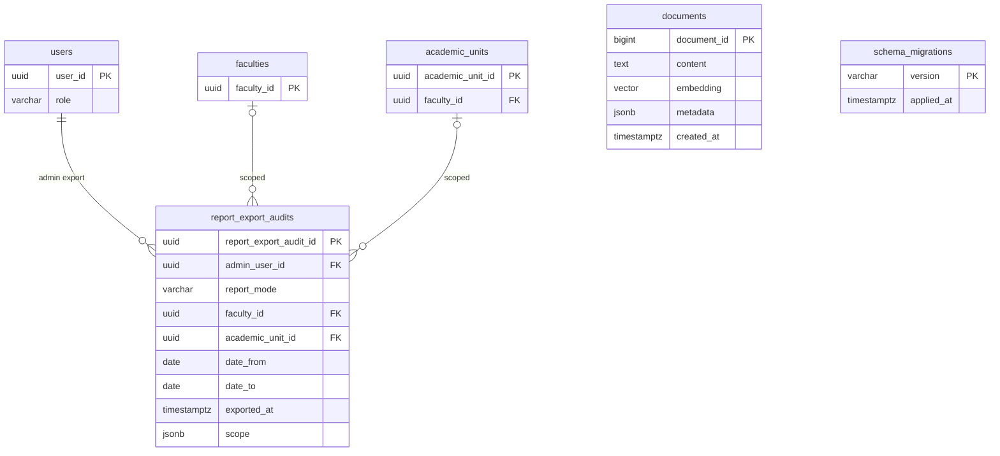

---

## Master relationship index

| From (FK column) | To (target) | On delete |
|---|---|---|
| privacy_consents.user_id | users.user_id | CASCADE |
| student_academic_profiles.user_id | users.user_id | CASCADE |
| student_academic_profiles.faculty_id | faculties.faculty_id | RESTRICT |
| student_academic_profiles.(academic_unit_id, faculty_id) | academic_units | RESTRICT |
| academic_units.faculty_id | faculties.faculty_id | RESTRICT |
| sessions.user_id | users.user_id | CASCADE |
| messages.(session_id, user_id) | sessions | CASCADE |
| journals.user_id | users.user_id | CASCADE |
| guardrail_logs.user_id | users.user_id | SET NULL |
| guardrail_logs.assessment_id | assessments.assessment_id | SET NULL |
| assessments.user_id | users.user_id | CASCADE |
| assessments.instrument_version_id | assessment_instrument_versions | RESTRICT |
| assessment_category_results.assessment_id | assessments | CASCADE |
| assessment_category_results.instrument_version_id | assessment_instrument_versions | RESTRICT |
| assessment_instruments.derived_from_instrument_id | assessment_instruments | RESTRICT |
| assessment_instruments.created_by / updated_by | users | RESTRICT |
| assessment_instrument_versions.instrument_id | assessment_instruments | RESTRICT |
| assessment_instrument_versions.created_by / updated_by / published_by | users | RESTRICT |
| assessment_questions.instrument_version_id | assessment_instrument_versions | CASCADE |
| assessment_questions.dimension_id | assessment_dimensions | RESTRICT |
| assessment_answer_options.assessment_question_id | assessment_questions | CASCADE |
| assessment_dimensions.instrument_version_id | assessment_instrument_versions | CASCADE |
| assessment_version_reviews.instrument_version_id | assessment_instrument_versions | RESTRICT |
| assessment_version_reviews.submitted_by / reviewer_user_id | users | RESTRICT |
| assessment_review_comments.assessment_version_review_id | assessment_version_reviews | CASCADE |
| assessment_review_comments.assessment_question_id | assessment_questions | SET NULL |
| assessment_review_comments.author_user_id | users | RESTRICT |
| hotlines.verified_by / updated_by | users | RESTRICT |
| student_support_profiles.user_id | users | CASCADE |
| student_support_profiles.updated_by | users | RESTRICT |
| counseling_requests.student_id | users | CASCADE |
| counseling_requests.preferred_counselor_id | users | SET NULL |
| counseling_appointments.counseling_request_id | counseling_requests | RESTRICT |
| counseling_appointments.legacy_counseling_booking_id | counseling_bookings | RESTRICT |
| counseling_appointments.student_id / counselor_id / created_by | users | RESTRICT |
| counseling_appointments.counseling_resource_id | counseling_resources | RESTRICT |
| counseling_appointment_events.counseling_appointment_id | counseling_appointments | CASCADE |
| counseling_appointment_events.actor_user_id | users | RESTRICT |
| counseling_admin_notes.counseling_request_id | counseling_requests | CASCADE |
| counseling_admin_notes.counseling_appointment_id | counseling_appointments | CASCADE |
| counseling_admin_notes.author_user_id | users | RESTRICT |
| counseling_resources.created_by | users | RESTRICT |
| counseling_resource_blocks.counseling_resource_id | counseling_resources | CASCADE |
| counseling_resource_blocks.created_by | users | RESTRICT |
| counselor_profiles.user_id | users | CASCADE |
| counselor_availability_rules.counselor_id | users | CASCADE |
| counselor_blocked_periods.counselor_id | users | CASCADE |
| counselor_blocked_periods.created_by | users | RESTRICT |
| counselor_case_assignments.counselor_id | users | RESTRICT |
| counselor_case_assignments.student_id | users | CASCADE |
| counselor_case_assignments.created_by / revoked_by | users | SET NULL |
| counselor_exception_requests.counselor_id | users | RESTRICT |
| counselor_exception_requests.reviewed_by | users | SET NULL |
| counselor_exception_requests.counselor_blocked_period_id | counselor_blocked_periods | SET NULL |
| counseling_slots.counselor_id | users | CASCADE |
| counseling_bookings.counseling_slot_id | counseling_slots | RESTRICT |
| counseling_bookings.student_id | users | CASCADE |
| admin_notifications.admin_user_id | users | CASCADE |
| notifications.user_id | users | CASCADE |
| report_export_audits.admin_user_id | users | RESTRICT |
| report_export_audits.faculty_id | faculties | RESTRICT |
| report_export_audits.academic_unit_id | academic_units | RESTRICT |
